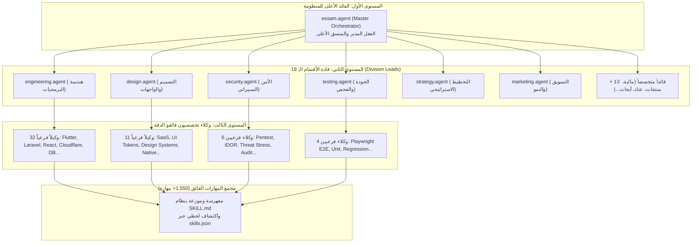

# 🚀 الدليل التعريفي الشامل: الخبرات الهندسية، منظومة وكلاء الذكاء الاصطناعي، والتحليل الرقمي

### المهندس عصام الخطيب — مؤسس الإدارة الهندسية لشركة AstroDev للحلول الرقمية

---

## 👤 1. نبذة تعريفية سريعة

**المهندس عصام الخطيب**؛ مهندس برمجيات متكامل (Full-Stack)، مطور تطبيقات هاتف ذكية (Flutter)، ومصمم تجربة وواجهة مستخدم (UI/UX).

- **الموقع الشخصي ومعرض الأعمال الرسمي:** [essamalkhateeb.com](https://essamalkhateeb.com)
- **موقع شركة AstroDev للحلول الرقمية:** [astrodevye.com](https://astrodevye.com)

يجمع بين العمق البرمجي المعماري، الرؤية الريادية لتحويل الأفكار إلى منصات مؤسسية تعمل على أرض الواقع، والقدرة التحليلية المتقدمة لبيانات السوق وشبكات التواصل الاجتماعي لخدمة أصحاب الأعمال.

---

## 💻 2. مجالات الخبرة والتمكن التقني (في ماذا أنا فاهم ومتقن؟)

### 🔹 أ. هندسة الويب وتطوير الخوادم الموسعة (Full-Stack & Backend)

- **إطار العمل الأساسي:** إتقان متقدم لـ **Laravel (الإصدارات 10، 11، 12)** ولغة **PHP** وقواعد بيانات **MySQL / PostgreSQL**.
- **الأنماط المعمارية:** تطبيق معمارية التطوير الموجه بالنطاقات (**Domain-Driven Design - DDD**)، نمط الخدمات (**Service-Repository Pattern**)، ومعمارية الكود النظيف (**Clean Architecture**).
- **الأمان والحوكمة:** تطبيق مصفوفات الأذونات والصلاحيات المتقدمة (**RBAC**) عبر `Spatie Permission`، سجلات التدقيق والأمان الرقمي اللحظي (**Audit Logs & Activity Tracking**)، وتأمين واجهات البرمجة بـ `Laravel Sanctum`.
- **بناء واجهات البرمجة (RESTful APIs):** هندسة واجهات برمجية عالية السرعة والأمان مصممة لربط لوحات التحكم السحابية بتطبيقات الهواتف المحمولة والأنظمة الخارجية.

### 🔹 ب. تطوير تطبيقات الجوال الميدانية (Flutter Mobile Apps)

- **تطبيقات متكاملة متعددة المنصات (iOS & Android):** مبنية بإطار العمل **Flutter & Dart** مع مراعاة أحدث معايير الأداء والواجهات السلسة.
- **معمارية العمل دون إنترنت (Offline-First Architecture):** تخصص فريد في بناء تطبيقات ميدانية تعمل بكفاءة 100% في البيئات الريفية والمناطق المنقطعة عن التغطية، مع تخزين محلي مشفر عبر `SQLite` ومزامنة تلقائية ذكية ثنائية الاتجاه مع السيرفر السحابي فور توفر الاتصال (مثل تطبيقات مناحل العسل والمتاجر الميدانية).
- **التكامل العتادي الميداني:** ربط التطبيقات المباشر بأجهزة نقاط البيع الميدانية (POS)، طابعات الفواتير البلوتوث والحرارية، وقوارئ الباركود ومحركات الـ QR Code.

### 🔹 ج. هندسة أنظمة الـ ERP والمنظومات الإدارية الحية

- **الرقابة الصيدلانية والمستودعات:** تتبع تواريخ الصلاحية آلياً وفق معيار **FEFO** (ما ينتهي أولاً يخرج أولاً)، وفحص التفاعلات والتعارضات الدوائية.
- **أنظمة المطاعم والكافيهات:** شاشات تحضير المطبخ والباريستا الحية (**Live KDS**)، حجوزات الطاولات، طلبات الدرايف ثرو، وأتمتة القيود المالية والمبيعات.
- **أنظمة المؤسسات التعليمية (SIS / School ERP):** رصد الحضور الذكي والغياب المتكرر، جداول الحصص، النتائج والشهادات والرسوم.
- **المنصات الخدمية والذكية:** أدوات استعلام أرصدة الاتصالات (تجاوز الكابتشا وهندسة عكسية للبيانات)، ونظم الملاحة الحضرية وتتبع الحافلات بخرائط الـ GIS.

### 🔹 د. تصميم تجربة وواجهة المستخدم (UI/UX Design)

- **تصميم الأنظمة البصرية (Design Systems):** بناء واجهات احترافية تتسم بالتناسق العالي، التباين المريح، والميكرو-أنيميشن التفاعلي.
- **دعم ثنائي كامل (RTL / LTR):** هندسة الواجهات باللغتين العربية والإنجليزية بشكل عضوي متناسق، مع دعم التبديل التلقائي بين الوضع الليلي والنهاري (Dark & Light Modes).

---

## 🤖 3. منظومة الوكلاء والذكاء الاصطناعي (3-Tier Hierarchical Multi-Agent Architecture)

ابتكرتُ وطورتُ منظومة ذكاء اصطناعي متعددة الوكلاء تعد من أكثر المنظومات تنظيماً وتطوراً، حيث صُممت لتعمل مثل **شركة برمجية متكاملة ذاتية الإدارة**، مع منع التشتت والهلوسة (**Zero Hallucination**) وضمان أعلى درجات الدقة الحتمية:

### 🧠 الركائز الأساسية لمنظومة الوكلاء:

1. **المستوى الأول (Tier 1 - Master Orchestrator):** يمثله الوكيل الأعلى `essam.agent`؛ وظيفته فهم الرؤية العامة، تفكيك المشاريع الكبرى إلى مهام هندسية واضحة، وتوجيهها للمستوى الثاني.
2. **المستوى الثاني (Tier 2 - Division Leads):** يتألف من **19 وكيلاً قائداً** يمثل كل منهم قسماً مستقلاً (الهندسة، التصميم، الأمن السيبراني، الجودة، التسويق، الاستراتيجية، إدارة المنتجات، إلخ).
3. **المستوى الثالث (Tier 3 - Specialized Sub-Agents):** شبكة تضم أكثر من **54 وكيلاً تخصصياً دقيقاً**؛ كل وكيل مسؤول فقط عن مجال ضيق جداً (مثل: وكيل خاص بـ Flutter، وكيل لـ Laravel DDD، وكيل لاختبارات الاختراق Pentest، وكيل لفحوصات Playwright E2E)، مما يمنع خلط المفاهيم ويحقق دقة صفرية في الأخطاء.
4. **مجمع المهارات الضخم (Skills Ecosystem):** يضم أكثر من **1,550 مهارة برمجية وتنفيذية** بصيغة `SKILL.md`، ترتبط بفهرس سريع `skills.json` يتيح للوكلاء استدعاء المهارة المطلوبة تدريجياً وبشكل لحظي (Progressive Loading).
5. **الحوكمة وقواعد الجودة الصارمة:**
   - **مبادئ أندريه كارباثي البرمجية (Karpathy Guidelines):** التفكير المعماري قبل الكتابة، تبسيط الحلول وتجنب التعقيد غير المبرر، والتعديلات الجراحية الدقيقة.
   - **سياسة الموافقة على الخطة (Plan Approval Policy):** حظر التنفيذ التلقائي إلا بعد تقديم خطة فنية مفصلة والحصول على اعتمادها.
6. **مرونة التضمين والتشغيل داخل أي نظام شغال (Embedded Production-Ready Agents):**  
   المنظومة ليست مجرد بيئة تطوير معزولة، بل مصممة هندسياً لتقبل **التضمين والدمج المباشر داخل أي نظام برمجي قائم وشغال فعلياً** (سواء كان مبنياً بـ **PHP / Laravel**، **Node.js**، أو غيرها)، مما يسمح بزرع "عقل ذكي" داخل النظام لأتمتة العمليات الحية واتخاذ القرارات البرمجية والتشغيلية.

### 🔌 تكامل وتضمين الوكلاء داخل الأنظمة الحية (Embedded Agents in Production Systems)

لا يتطلب استخدام منظومة الوكلاء إعادة بناء نظامك من الصفر؛ حيث تدعم أنماط تكامل مرنة وسريعة تناسب أي معمارية شغالّة:

1. **التضمين البرمجي المباشر (Native In-App Agents):**
   - ربط مهارات الوكلاء (Skills) بدوال النظام الحقيقية عبر **Function Calling / Tools**.
   - يستطيع الوكيل قراءة وكتابة البيانات مباشرة في قواعد البيانات (MySQL / PostgreSQL)، واستدعاء خدمات النظام (Services & Repositories) بأمان تام وتحت مظلة أذونات الـ RBAC.
2. **بنية الخدمة المصغرة الذكية (Microservice / Sidecar Agent):**
   - تشغيل الوكيل كـ Engine مستقل يتصل بنظامك عبر **REST APIs** أو **Webhooks** أو **Message Queues (Redis / RabbitMQ)** لمعالجة المهام الثقيلة في الخلفية دون التأثير على استجابة النظام.
3. **المساعد الذكي المدمج في لوحات التحكم (Embedded Co-Pilot):**
   - زرع الوكلاء كواجهات ذكية داخل لوحات إدارة الـ ERP، أنظمة المبيعات، وتطبيقات الهواتف لمساعدة الموظفين والمديرين في اتخاذ القرارات اللحظية، تلخيص المؤشرات، واستخراج التحليلات المعقدة.

---

## 📊 4. القدرة التحليلية المتقدمة لصفحات التواصل الاجتماعي وبيانات السوق

لا تقتصر خبرتي على البرمجة الصرفة، بل أمتلك منهجية مثبتة في **دراسة وتشخيص الحضور الرقمي وتحليل صفحات السوشيال ميديا** لأي نشاط تجاري لتحويل المتابعين إلى مبيعات وأنظمة تقنية:

### 🔍 محاور التحليل التي أتقنها:

1. **تحليل المحتوى والمنشورات (Content & Engagement Analytics):**
   - تفكيك المنشورات، قياس معدلات الوصول والتفاعل الطبيعي، ومعرفة أفضل أنواع المحتوى جذباً للعملاء.
   - قياس قوة العلامة التجارية ونقاط الضعف في الهوية الرقمية.
2. **تحليل مشاعر الجمهور والتعليقات (Sentiment & Comments Analysis):**
   - الفحص الدقيق لردود وتعليقات الزبائن، تصنيفها إلى (إيجابية، سلبية، استفسارات، رغبات شراء، شكاوى).
   - استخراج المشاكل التشغيلية التي يعاني منها الزبائن على أرض الواقع من واقع تعليقاتهم (مثل بطء التوصيل، الازدحام، مشاكل التسعير).
3. **استكشاف حاجة النشاط التجاري للتحول الرقمي (App Demand & Digital Conversion):**
   - رصد الطلبات المتكررة من الجمهور لـ "تطبيق هاتف"، "خدمة توصيل"، أو "شراء أونلاين".
   - تقديم مقترحات تقنية قابلة للتنفيذ المباشر: ربط صفحة التواصل بتطبيق جوال ذكي ونظام كاشير POS موحد.
4. **دراسة المنافسين وتصميم خطط النمو (Competitors Analysis & 3-Month Plans):**
   - مقارنة النشاط التجاري بمنافسيه المباشرين في السوق المحلي واستخراج الفجوات (Gaps).
   - رسم جداول محتوى تسويقي مدروس لـ 3 أشهر قادمة مع خطط تحويل المتابعين إلى عملاء فعليين (Conversion Strategy).

### 🏆 نماذج واقعية من دراساتي التحليلية المنجزة:

- **ملك الفواكه (King of Fruits):** تحليل شامل لأكثر من 50 منشوراً، دراسة مشاعر جمهور 15 منشوراً تفاعلياً، تشخيص مشاكل بطء الكاشير في الفروع، وتقديم مقترح متكامل لتطبيق جوال يربط الفروع بنقاط البيع.
- **أصل العنب (Aslaleanab):** تحليل 20 منشوراً تفاعلياً، دراسة تفاعل العملاء، وإعداد خطة لإدارة الصفحات وجدول محتوى شهري مصحوب بحل تقني.
- **نواة كافيه (Nawah Coffee):** دراسة منشورات المقهى، رصد رغبات الزبائن في تطبيق للطلبات المسبقة، وتشخيص النظام التقني المطلوب لخدمة الكافيه.
- **نيلوفر ستور (Nioulfar Store):** تحليل شامل لصفحات فيسبوك وإنستغرام وكتالوج واتساب، دراسة المنافسين، ورسم خطة تسويقية متكاملة لثلاثة أشهر.

---

## 🚀 5. محفظة المنظومات والمشاريع الحية المنجزة (16+ مشروعاً)

| المشروع                      | مجال العمل                | التقنيات الأساسية                  | الميزة الفريدة والابتكار                                              |
| :--------------------------- | :------------------------ | :--------------------------------- | :-------------------------------------------------------------------- |
| **Barista Hub (القهوة)**     | مقاهي ومشروبات ذكية       | Flutter + Dashboard + KDS          | شاشة تحضير باريستا حية، درايف ثرو، ونقاط ولاء العملاء                 |
| **Honey Store (العسل)**      | تجارة ومناحل العسل        | Flutter (Offline-First) + Filament | عمل 100% دون إنترنت في الجبال، فواتير POS ميدانية، وتتبع الجودة بـ QR |
| **Dalil (دليل الاتصالات)**   | خدمات وأدوات الاتصالات    | Flutter Mobile App                 | هندسة عكسية لمودمات ADSL والاستعلام اللحظي عن رصيد يمن نت             |
| **Dalni (دلني للنقل الذكي)** | نقل حضري وملاحة           | PWA + MapLibre GIS + OSRM          | خوارزمية ذكية لتخطيط مسارات الحافلات وحساب الأجرة والوقت              |
| **Pharmacy**                 | الرعاية الصيدلانية        | Laravel + Flutter App              | فحص تعارضات الأدوية، تتبع الصلاحيات بـ FEFO، وقارئ باركود             |
| **Restaurant Fish**          | إدارة المطاعم ونقاط البيع | Laravel + POS + KOT                | ترحيل الطلبات للمطبخ، حجز الطاولات، والقيود المحاسبية التلقائية       |
| **School Management**        | إدارة المدارس والتعليم    | Laravel + SIS Core                 | رصد الغياب المتكرر، جداول الحصص والامتحانات، وإدارة الرسوم            |
| **Code Blog**                | تدوين ومجتمعات تقنية      | Laravel 12 + Tailwind              | تسجيل دخول اجتماعي OAuth، معالجة ذكية للصور، ونشرة بريدية             |
| **E-Book Store**             | تجارة المحتوى والكتب      | Laravel + DRM Protection           | معاينة فصول الكتب، تنزيل مؤمن بعد الدفع، ونظام كوبونات                |
| **E-Commerce ERP**           | تجارة إلكترونية ومخازن    | Laravel 12 + ERP Core              | إدارة الموردين، المقاسات والألوان، وتتبع الشحنات وسلسلة الإمداد       |
| **Sim Save**                 | أصول وشرائح الاتصال       | Flutter + Responsive Web           | خوارزمية التنبؤ بنفاد الرصيد وحماية الخطوط من الإلغاء بالشحن الذاتي   |
| **Masar (مسار الجامعي)**     | منصة الجامعات الموحدة     | Laravel 12 API + Flutter           | مسار تصديق الشهادات والوثائق، وغرف دردشة أكاديمية                     |
| **Al-Qadasi (القدسي)**       | المشغولات المعدنية والورش | Web + 2 Flutter Apps               | كتالوج تفاعلي للمداخل والليزر مع وضع العلامة المائية آلياً            |

---

## 💡 الخلاصة والقيمة المضافة التي أقدمها

1. **الجمع الفريد بين البرمجة وإدارة الأعمال:** لست مجرد مبرمج يكتب كوداً، بل أستوعب دورة حياة المشروع كبزنس متكامل يبدأ من تحليل السوق ورغبات الجمهور على منصات التواصل، مروراً بتصميم الواجهات، وانتهاءً بهندسة السيرفرات والتطبيقات.
2. **الابتكار في الذكاء الاصطناعي وهندسة الوكلاء المدمجة:** بناء منظومة وكلاء ذكية مخصصة، مع القدرة الكاملة على **تضمينها ودمجها داخل أي نظام مؤسسي قائم (مثل PHP / Laravel)** لرفع كفاءته التشغيلية وأتمتة عملياته الحية.
3. **الجودة والموثوقية:** الالتزام الصارم بالأنماط المعمارية العالمية، الكود النظيف، وأقصى درجات الأمان وحماية البيانات.

---
